# Dress Up: what stands in each place

The formal list of every place's objects (ticket 99), as of 0.0.392, at the default settings, each with its picture (ticket 180). A slider that adds things (more toys, more ducks, more chairs) adds objects.

- **Depth** is the y where a thing stands on the ground, in the stage's units: the ground line is at 320, and the friend's feet can be anywhere from about 11 (far) to 406 (near).
- The friend is drawn behind every object deeper than their feet, and in front of the rest. **wall** and **floor** (ticket 284) are things hanging on a wall or lying on the floor: objects too, listed, hidden and placed as any other, but always behind the friend and in nobody's way. **front** means in front of everything: the friend is always under it (darkness, light, steam, the sign toward us).
- Flat things on the ground and the backdrop (sky, far hills, back walls and what hangs on them) are not objects. What is drawn into a place but is not an object, the audit of ticket 284, is [BAKED-IN.md](BAKED-IN.md); since 0.0.208 every object here can be placed in any place (📦 from the places).
- In the game each place shows this list in its background tab, with an 👁️ chip per object to hide or show it.
- **The pictures:** each place as it starts, the friend hidden and its animations held still; each object clipped from that picture by its box on the screen, so what stands near it shows too. Drawn by GitHub's headless Chrome.

Made by `tools/checks/objects180.mjs` (on GitHub's computers: push a branch carrying it) and `tools/objects_md.py`. Make it again after changing what stands in a place.

## 🔲 empty room

(0.0.77, ticket 153.) Nothing stands here: the friend is in front of everything. Its back wall is solid, as the imagination's is.

## 🫧 bubble space

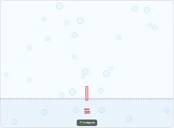

| depth | object | picture |
|---:|---|---|
| front | bubbles |  |

## 🫧 the bubble room

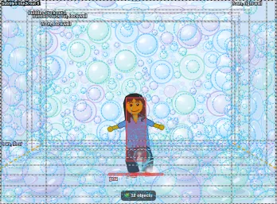

| depth | object | picture |
|---:|---|---|
| wall | foam, back wall | 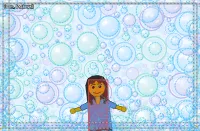 |
| wall | foam, left wall | 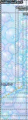 |
| wall | foam, right wall | 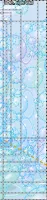 |
| floor | foam, floor |  |
| wall | foam, ceiling |  |
| wall | bubbles stuck out, back wall | 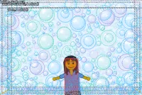 |
| 255.6 | bubbles stuck out 1 | 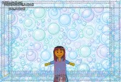 |
| 285.5 | bubbles stuck out 2 | 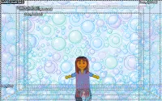 |
| 315.7 | bubbles stuck out 3 | 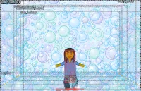 |
| 344.5 | bubbles stuck out 4 | 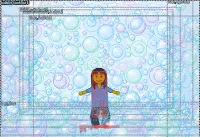 |
| 374.3 | bubbles stuck out 5 | 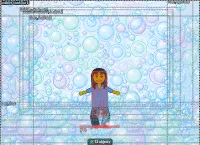 |
| 819.7 | bubbles stuck out 6 | 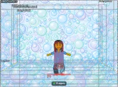 |

## 💭 our imagination

(0.0.75, ticket 145: its ladders, one at each column's right, at the wall's foot. Its back wall is solid: the friend's feet stay at 271.5 or nearer.)

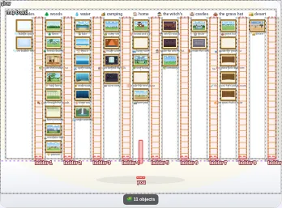

| depth | object | picture |
|---:|---|---|
| wall | glow | 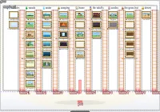 |
| wall | map board | 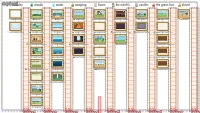 |
| 268.5 | ladder 1 | 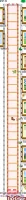 |
| 268.5 | ladder 2 |  |
| 268.5 | ladder 3 | 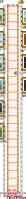 |
| 268.5 | ladder 4 | 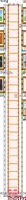 |
| 268.5 | ladder 5 | 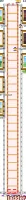 |
| 268.5 | ladder 6 |  |
| 268.5 | ladder 7 |  |
| 268.5 | ladder 8 | 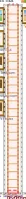 |
| 268.5 | ladder 9 | 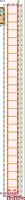 |

## 🌲 forest

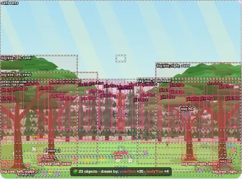

| depth | object | picture |
|---:|---|---|
| wall | sunbeams | 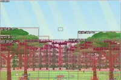 |
| 234.1 | pines, far row | 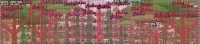 |
| 277.1 | pines, near row | 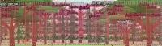 |
| 285.6 | butterflies | 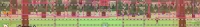 |
| 304 | flowers 1 | 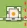 |
| 314.3 | flowers 2 |  |
| 324.6 | flowers 3 |  |
| 335 | flowers 4 |  |
| 345.3 | flowers 5 |  |
| 345.8 | big tree, left, inner | 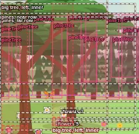 |
| 345.8 | big tree, right, inner | 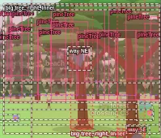 |
| 355.6 | flowers 6 | 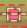 |
| 365.9 | flowers 7 | 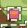 |
| 371.5 | big tree, left, outer | 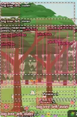 |
| 371.5 | big tree, right, outer | 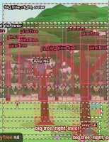 |
| 376.2 | flowers 8 |  |
| 386.5 | flowers 9 | 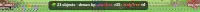 |
| 396.8 | flowers 10 |  |
| front | way N | 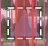 |
| front | way NE | 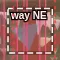 |
| front | way E | 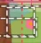 |
| front | way SE | 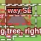 |
| front | way S | 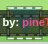 |

## 🐠 underwater

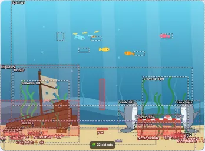

| depth | object | picture |
|---:|---|---|
| wall | light rays | 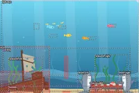 |
| wall | far kelp | 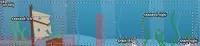 |
| floor | sand specks | 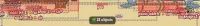 |
| floor | clam |  |
| 242.7 | school of fish |  |
| 259.9 | orange fish |  |
| 259.9 | yellow fish |  |
| 259.9 | pink fish | 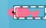 |
| 259.9 | blue fish |  |
| 337.2 | seaweed, left | 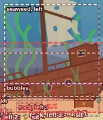 |
| 337.2 | seaweed, right | 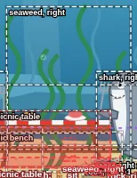 |
| 340.6 | rock, left 3 |  |
| 344.7 | rock, left 2 |  |
| 345.8 | shipwreck | 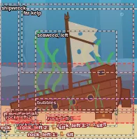 |
| 345.8 | picnic bench | 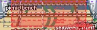 |
| 345.8 | shark, left | 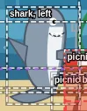 |
| 345.8 | shark, right | 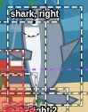 |
| 345.8 | picnic table |  |
| 347.2 | rock, right 2 |  |
| 358.9 | rock, right 1 |  |
| 362.3 | rock, left 1 |  |
| front | bubbles |  |

## 🪸 deep sea

| depth | object | picture |
|---:|---|---|
| wall | light rays |  |
| floor | ripples in the sand |  |
| 238.4 | school of fish |  |
| 340.6 | kelp, left |  |
| 340.6 | kelp, right |  |
| 342 | rock, left 2 |  |
| 349.8 | rock, left 1 |  |
| 354.4 | vent |  |
| 354.5 | rock, right 2 |  |
| 365.4 | rock, right 1 |  |
| front | way E |  |
| front | way S |  |

## 🏖️ beach

| depth | object | picture |
|---:|---|---|
| floor | beach blanket, left |  |
| floor | beach blanket, right |  |
| 328.6 | beach chair, left |  |
| 328.6 | beach chair, right |  |
| 337.2 | umbrella, left |  |
| 337.2 | umbrella, right |  |
| 354.4 | palm tree, left |  |
| 354.4 | palm tree, right |  |
| 358.6 | sand castle, left |  |
| 358.6 | sand castle, right |  |
| front | way N |  |
| front | way NE |  |
| front | way E |  |
| front | way SE |  |
| front | way S |  |
| front | way SW |  |
| front | way W |  |
| front | way NW |  |

## 🌊 open water

| depth | object | picture |
|---:|---|---|
| floor | sun glitter |  |
| front | way E |  |
| front | way SE |  |
| front | way SW |  |
| front | way W |  |

## 🧙 witch's woods

| depth | object | picture |
|---:|---|---|
| wall | bats |  |
| 212.6 | dead tree, far 1 |  |
| 212.6 | dead tree, far 2 |  |
| 212.6 | dead tree, far 3 |  |
| 212.6 | dead tree, far 4 |  |
| 212.6 | dead tree, far 5 |  |
| 212.6 | dead tree, far 6 |  |
| 212.6 | dead tree, far 7 |  |
| 212.6 | dead tree, far 8 |  |
| 212.6 | dead tree, far 9 |  |
| 245.3 | dead tree, near 1 |  |
| 245.3 | dead tree, near 2 |  |
| 245.3 | dead tree, near 3 |  |
| 245.3 | dead tree, near 4 |  |
| 245.3 | dead tree, near 5 |  |
| 245.3 | dead tree, near 6 |  |
| 245.3 | dead tree, near 7 |  |
| 245.3 | dead tree, near 8 |  |
| 278.8 | hut |  |
| 293.7 | grass 1 |  |
| 297.7 | fence |  |
| 297.7 | skull 1 |  |
| 297.7 | skull 2 |  |
| 297.7 | skull 3 |  |
| 297.7 | skull 4 |  |
| 297.7 | skull 5 |  |
| 297.7 | skull 6 |  |
| 297.7 | skull 7 |  |
| 297.7 | skull 8 |  |
| 297.7 | skull 9 |  |
| 297.7 | skull 10 |  |
| 297.7 | skull 11 |  |
| 304 | grass 2 |  |
| 314.3 | grass 3 |  |
| 335 | grass 4 |  |
| 345.3 | grass 5 |  |
| 354.4 | giant tree |  |
| 354.4 | tree, right |  |
| 355.6 | grass 6 |  |
| 364.7 | skeleton, left |  |
| 365.9 | grass 7 |  |
| 367.2 | cauldron |  |
| 376.2 | grass 8 |  |
| 376.7 | skeleton, right |  |
| 380.1 | skeleton, right edge |  |
| 383.6 | skeleton, left edge |  |
| 396.8 | grass 9 |  |
| front | way E |  |
| front | way SE |  |
| front | way S |  |

## 🌿 cemetery

| depth | object | picture |
|---:|---|---|
| floor | stones by the brook |  |
| 242.7 | far trees |  |
| 259.9 | butterflies |  |
| 275.3 | far stones |  |
| 293.7 | flowers 1 |  |
| 294.2 | yellow bush |  |
| 301.5 | willow |  |
| 304 | flowers 2 |  |
| 314.3 | flowers 3 |  |
| 318.3 | green bush |  |
| 323.4 | headstone, left |  |
| 324.6 | flowers 4 |  |
| 325.2 | cross |  |
| 335 | flowers 5 |  |
| 342.3 | headstone, right |  |
| 345.3 | flowers 6 |  |
| 345.8 | stag stone |  |
| 345.8 | pink bush |  |
| 349.2 | white bush |  |
| 355.6 | flowers 7 |  |
| 376.2 | flowers 8 |  |
| 386.5 | flowers 9 |  |
| 396.8 | flowers 10 |  |
| front | way N |  |
| front | way NE |  |
| front | way E |  |
| front | way W |  |
| front | way NW |  |

## 🦆 lake

| depth | object | picture |
|---:|---|---|
| floor | sun on the water |  |
| floor | lily pads |  |
| floor | pebbles |  |
| 105.3 | far wood |  |
| 125.8 | duck 1 |  |
| 142.9 | duck 5 |  |
| 167.2 | duck 3 |  |
| 192.6 | duck 2 |  |
| 198.8 | duck 4 |  |
| 264.2 | cattails, left |  |
| 264.2 | cattails, right |  |
| 273.1 | grass 1 |  |
| 293.7 | grass 2 |  |
| 304 | grass 3 |  |
| 314.3 | grass 4 |  |
| 324.6 | grass 5 |  |
| 335 | grass 6 |  |
| 345.3 | grass 7 |  |
| 355.6 | grass 8 |  |
| 365.9 | grass 9 |  |
| 376.2 | grass 10 |  |
| 386.5 | grass 11 |  |
| 396.8 | grass 12 |  |
| 407.1 | grass 13 |  |
| front | way N |  |
| front | way E |  |
| front | way SE |  |
| front | way S |  |
| front | way SW |  |
| front | way W |  |
| front | way NW |  |

## 🏠 house and yard

| depth | object | picture |
|---:|---|---|
| floor | frisbee |  |
| floor | rope |  |
| 191.2 | house |  |
| 208.3 | tree, left |  |
| 216.9 | tree, right |  |
| 237.7 | teddy |  |
| 239.6 | truck 2 |  |
| 250.3 | wagon |  |
| 251.1 | ball |  |
| 268.4 | blocks |  |
| 268.5 | butterflies |  |
| 280.8 | truck |  |
| 357.3 | ball 2 |  |
| 366.2 | bucket |  |
| front | way N |  |
| front | way NE |  |
| front | way E |  |
| front | way SE |  |
| front | way S |  |
| front | way SW |  |
| front | way W |  |
| front | way NW |  |

## 🚜 farm yard

| depth | object | picture |
|---:|---|---|
| wall | far mountains |  |
| wall | far forest |  |
| wall | fields |  |
| floor | grass by the fence |  |
| floor | wheel ruts |  |
| floor | pebbles |  |
| floor | straw |  |
| 213.5 | red barn |  |
| 215.2 | farmhouse |  |
| 239.3 | fence, back |  |
| 259.9 | windpump |  |
| 265 | tractor |  |
| 278.8 | water trough |  |
| 289.1 | hen, black |  |
| 342.3 | hen, white |  |
| 345.8 | blowing straw |  |
| 362.9 | haystack |  |
| 373.2 | hen, brown |  |

## 🌳 tree house

| depth | object | picture |
|---:|---|---|
| 214.4 | trees, far row |  |
| 268.5 | butterflies |  |
| 287.4 | trees, left |  |
| 287.4 | trees, right |  |
| 304 | flowers 1 |  |
| 307.9 | bush, left 5 |  |
| 309.4 | bush, left 1 |  |
| 314.2 | bush, left 4 |  |
| 314.3 | flowers 2 |  |
| 315.5 | bush, right 3 |  |
| 320 | tree house |  |
| 320 | tree house 4 |  |
| 320 | tree house 3 |  |
| 320 | tree house 2 |  |
| 320 | tree house 1 |  |
| 320.7 | bush, left 8 |  |
| 324.6 | flowers 3 |  |
| 334.9 | bush, right 1 |  |
| 335 | flowers 4 |  |
| 337.3 | bush, left 6 |  |
| 337.7 | bush, right 2 |  |
| 341.5 | bush, left 3 |  |
| 342.6 | bush, left 2 |  |
| 345.3 | flowers 5 |  |
| 345.5 | bush, right 8 |  |
| 346.8 | bush, left 7 |  |
| 355.6 | flowers 6 |  |
| 365.9 | flowers 7 |  |
| 376.2 | flowers 8 |  |
| 386.5 | flowers 9 |  |
| 396.8 | flowers 10 |  |
| front | way S |  |
| front | way SW |  |
| front | way W |  |

## 🛋️ living room

| depth | object | picture |
|---:|---|---|
| floor | rug |  |
| wall | wall clock |  |
| wall | window and curtains |  |
| 242.7 | lamp |  |
| 259.9 | plant |  |
| 285.6 | couch |  |
| front | way S |  |

## 🧙 inside the witch's hut

| depth | object | picture |
|---:|---|---|
| wall | round window |  |
| wall | window, left |  |
| wall | window, right |  |
| wall | drying herbs 1 |  |
| wall | drying herbs 2 |  |
| wall | drying herbs 3 |  |
| wall | drying herbs 4 |  |
| wall | drying herbs 5 |  |
| wall | drying herbs 6 |  |
| wall | drying herbs 7 |  |
| wall | drying herbs 8 |  |
| wall | cobweb, left |  |
| wall | cobweb, right |  |
| wall | shelf of potions |  |
| wall | frogs in jars |  |
| wall | crow in a cage 1 |  |
| wall | crow in a cage 2 |  |
| wall | crow in a cage 3 |  |
| 253 | snake tank |  |
| 277.1 | cauldron |  |
| 320 | witch |  |
| front | dark |  |

## 🌲 forest clearing

| depth | object | picture |
|---:|---|---|
| 136.2 | far woods |  |
| 204.9 | castle |  |
| 205.3 | tree house |  |
| 226.6 | house |  |
| 252.3 | witch hut |  |
| 271.2 | healer hut |  |
| 304 | flowers 1 |  |
| 314.3 | flowers 2 |  |
| 324.6 | flowers 3 |  |
| 335 | flowers 4 |  |
| 345.3 | flowers 5 |  |
| 345.8 | butterflies |  |
| 354.4 | tree, left, outer |  |
| 354.4 | tree, right, outer |  |
| 355.6 | flowers 6 |  |
| 365.9 | flowers 7 |  |
| 376.2 | flowers 8 |  |
| 386.5 | flowers 9 |  |
| 388.7 | tree, left, inner |  |
| 388.7 | tree, right, inner |  |
| 396.8 | flowers 10 |  |
| 407.1 | flowers 11 |  |
| front | way N |  |
| front | way NE |  |
| front | way E |  |
| front | way SE |  |
| front | way S |  |
| front | way SW |  |
| front | way W |  |
| front | way NW |  |

## 🌿 inside the healer's hut

| depth | object | picture |
|---:|---|---|
| floor | rug |  |
| wall | round window |  |
| wall | drying herbs 1 |  |
| wall | drying herbs 2 |  |
| wall | drying herbs 3 |  |
| wall | drying herbs 4 |  |
| wall | drying herbs 5 |  |
| wall | drying herbs 6 |  |
| wall | drying herbs 7 |  |
| wall | drying herbs 8 |  |
| wall | drying herbs 9 |  |
| wall | drying herbs 10 |  |
| wall | fireplace |  |
| wall | things on the mantel |  |
| 234.1 | potion shelves |  |
| 234.1 | cat |  |
| 320 | soup pot |  |
| 320 | healer |  |
| 385.3 | tea table |  |
| 387 | chair, left |  |
| 387 | chair, right |  |
| 392.1 | worktable |  |
| front | warm light |  |

## 🧚 fairy forest

| depth | object | picture |
|---:|---|---|
| 196.3 | trees, far row |  |
| 230.7 | trees, near row |  |
| 316.8 | toadstool 11 |  |
| 317.5 | toadstool 12 |  |
| 324 | toadstool 10 |  |
| 325.2 | bush |  |
| 325.4 | toadstool 13 |  |
| 333.6 | toadstool 9 |  |
| 335 | flowers and grass 1 |  |
| 337.2 | great tree |  |
| 337.2 | fairy house |  |
| 341.5 | toadstool 14 |  |
| 345.3 | flowers and grass 2 |  |
| 349.4 | toadstool 8 |  |
| 355.6 | flowers and grass 3 |  |
| 357.2 | toadstool 1 |  |
| 365.9 | flowers and grass 4 |  |
| 370.6 | toadstool 7 |  |
| 371.5 | stone, left |  |
| 371.7 | toadstool 2 |  |
| 376.2 | flowers and grass 5 |  |
| 382.7 | toadstool 6 |  |
| 386.5 | flowers and grass 6 |  |
| 386.7 | toadstool 3 |  |
| 390.7 | toadstool 5 |  |
| 391.7 | toadstool 4 |  |
| 396.8 | flowers and grass 7 |  |
| 397.3 | stone, right |  |
| 407.1 | flowers and grass 8 |  |
| 417.4 | flowers and grass 9 |  |
| front | sparkles |  |
| front | way N |  |
| front | way SW |  |
| front | way W |  |
| front | way NW |  |

## ⛰️ mountain trail

| depth | object | picture |
|---:|---|---|
| wall | far lake and village |  |
| 191.2 | birds |  |
| 322.9 | pine, right 1 |  |
| 326.6 | pine, right 4 |  |
| 327.6 | pine, right 2 |  |
| 329.6 | rock, left 5 |  |
| 330.2 | pine, left 2 |  |
| 334 | pine, left 3 |  |
| 338.2 | rock, left 2 |  |
| 338.9 | pine, right 3 |  |
| 339.1 | pine, left 1 |  |
| 344.1 | pine, left 4 |  |
| 349.1 | rock, right 4 |  |
| 351 | rock, left 4 |  |
| 351.7 | rock, left 1 |  |
| 355.9 | rock, left 3 |  |
| 364.1 | rock, right 2 |  |
| 364.7 | rock, right 3 |  |
| 369.1 | rock, right 1 |  |
| front | way E |  |
| front | way SE |  |
| front | way S |  |
| front | way SW |  |
| front | way W |  |

## 💦 jungle waterfall

| depth | object | picture |
|---:|---|---|
| 259.9 | mist |  |
| 259.9 | vines |  |
| 345.3 | flowers, left 1 |  |
| 345.3 | flowers, right 1 |  |
| 355.6 | flowers, left 2 |  |
| 355.6 | flowers, right 2 |  |
| 365.9 | flowers, left 3 |  |
| 365.9 | flowers, right 3 |  |
| 371.5 | jungle tree, left |  |
| 371.5 | jungle tree, right |  |
| 371.5 | parrot 1 |  |
| 371.5 | parrot 2 |  |
| 376.2 | flowers, left 4 |  |
| 376.2 | flowers, right 4 |  |
| front | way NE |  |
| front | way E |  |
| front | way SE |  |
| front | way S |  |

## 🏕️ camp site

| depth | object | picture |
|---:|---|---|
| 238.4 | woods |  |
| 285.6 | orange tent |  |
| 290.8 | blue tent |  |
| 354.4 | campfire |  |
| 392.1 | log, left |  |
| 392.1 | log, right |  |
| 452.3 | log, near |  |
| front | way N |  |
| front | way NE |  |
| front | way E |  |
| front | way SE |  |
| front | way S |  |
| front | way SW |  |
| front | way W |  |

## ⛺ inside a tent

| depth | object | picture |
|---:|---|---|
| wall | window, left |  |
| wall | window, right |  |
| floor | sleeping bag, red |  |
| floor | sleeping bag, purple |  |
| floor | flashlight |  |
| 302.8 | flashlight beam |  |

## 🪨 cave behind the falls

| depth | object | picture |
|---:|---|---|
| wall | gems |  |
| wall | crystals 1 |  |
| wall | crystals 2 |  |
| wall | crystals 3 |  |
| wall | archway to the cave room |  |
| floor | the floor's ledges |  |
| floor | wet floor |  |
| wall | light from the falls |  |
| floor | pebbles |  |
| 302.8 | big stalagmite, left |  |
| 302.8 | small stalagmite, left |  |
| 302.8 | big stalagmite, right |  |
| 302.8 | small stalagmite, right |  |
| 302.8 | stalactites |  |
| 302.8 | bats |  |
| 320 | chest |  |

## 🦇 cave room

| depth | object | picture |
|---:|---|---|
| wall | glowing patches |  |
| wall | archway to the cave |  |
| floor | the floor's ledges |  |
| floor | pebbles |  |
| floor | puddle |  |
| wall | the ceiling's stalactites |  |
| 222.6 | stalagmite 3 |  |
| 227.3 | stalagmite 2 |  |
| 230.5 | stalagmite 4 |  |
| 236.9 | stalagmite 1 |  |
| 284.7 | stalagmite 5 |  |
| 297.4 | stalagmite 6 |  |
| 345.2 | stalagmite 8 |  |
| 345.8 | drops |  |
| 354.7 | stalagmite 7 |  |
| front | the dark |  |

## 🥾 path through the woods

| depth | object | picture |
|---:|---|---|
| floor | pebbles on the path |  |
| 168.8 | far trees |  |
| 168.8 | sunbeams |  |
| 277.1 | butterflies |  |
| 337.2 | tree, left inner |  |
| 345.8 | tree, right inner |  |
| 350.9 | mushroom, right inner |  |
| 354.4 | mushroom, left inner |  |
| 371.5 | mushroom, right outer |  |
| 380.1 | tree, left outer |  |
| 380.1 | mushroom, left outer |  |
| 388.7 | tree, right outer |  |
| front | way N |  |
| front | way NE |  |
| front | way E |  |
| front | way S |  |
| front | way W |  |
| front | way NW |  |

## 🌾 pasture

| depth | object | picture |
|---:|---|---|
| wall | far mountains |  |
| wall | far forest |  |
| 180.9 | fence and gate |  |
| 201 | grass and flowers 1 |  |
| 224.7 | grazing horse, chestnut |  |
| 231.9 | grass and flowers 2 |  |
| 234.1 | grazing horse, bay |  |
| 238.4 | water trough |  |
| 247.9 | grazing horse, grey |  |
| 262.8 | grass and flowers 3 |  |
| 277.1 | big tree |  |
| 293.7 | grass and flowers 4 |  |
| 311.4 | butterflies |  |
| 324.6 | grass and flowers 5 |  |
| 355.6 | grass and flowers 6 |  |
| 386.5 | grass and flowers 7 |  |

## 🛤️ forest crossing

| depth | object | picture |
|---:|---|---|
| 57.2 | far trees |  |
| 57.2 | sunbeams |  |
| 277.1 | butterflies |  |
| front | way N |  |
| front | way E |  |
| front | way S |  |
| front | way W |  |

## 🏰 castle

| depth | object | picture |
|---:|---|---|
| wall | birds |  |
| 204.9 | trees, far row |  |
| 239.3 | trees, near row |  |
| 290.8 | castle |  |
| 290.8 | gate |  |
| 335 | flowers and grass 1 |  |
| 337.5 | well |  |
| 345.3 | flowers and grass 2 |  |
| 355.6 | flowers and grass 3 |  |
| 358.3 | hay cart |  |
| 365.9 | flowers and grass 4 |  |
| 370.2 | pennant, left |  |
| 370.2 | pennant, right |  |
| 371.5 | big tree, left, outer |  |
| 371.5 | big tree, right, outer |  |
| 372.3 | rock, left, inner |  |
| 376.2 | flowers and grass 5 |  |
| 376.7 | barrel, far |  |
| 379 | rock, right, outer |  |
| 383.6 | barrel, middle |  |
| 386.5 | flowers and grass 6 |  |
| 390.4 | rock, right, inner |  |
| 390.6 | rock, left, outer |  |
| 392.1 | barrel, near |  |
| 392.1 | crate |  |
| 396.8 | flowers and grass 7 |  |
| 407.1 | flowers and grass 8 |  |
| 414.5 | big tree, left, inner |  |
| 414.5 | big tree, right, inner |  |
| 417.4 | flowers and grass 9 |  |
| front | way S |  |
| front | way SW |  |
| front | way W |  |

## 🛖 grass hut

| depth | object | picture |
|---:|---|---|
| 148.2 | far woods |  |
| 273.1 | flowers 1 |  |
| 283.4 | flowers 2 |  |
| 285.6 | butterflies |  |
| 293.7 | flowers 3 |  |
| 304 | flowers 4 |  |
| 314.3 | flowers 5 |  |
| 324.6 | flowers 6 |  |
| 335 | flowers 7 |  |
| 340.6 | woodpile |  |
| 345.3 | flowers 8 |  |
| 355.6 | flowers 9 |  |
| 365.9 | flowers 10 |  |
| 376.2 | flowers 11 |  |
| 382.7 | hut |  |
| 386.5 | flowers 12 |  |
| 396.8 | flowers 13 |  |
| 407.1 | flowers 14 |  |

## 🛋️ inside the grass hut

| depth | object | picture |
|---:|---|---|
| floor | rug |  |
| wall | window |  |
| wall | wind chime |  |
| wall | lantern |  |
| 285.6 | couch |  |
| front | way S |  |

## 🛏️ the grass hut's bedroom

| depth | object | picture |
|---:|---|---|
| floor | rug |  |
| wall | window |  |
| wall | dreamcatcher |  |
| 337.2 | stump |  |
| 349.2 | bed |  |

## 🧪 the grass hut's potion room

| depth | object | picture |
|---:|---|---|
| wall | shelf of potions 1 |  |
| wall | shelf of potions 2 |  |
| wall | shelf of potions 3 |  |
| wall | beam |  |
| wall | drying herbs 1 |  |
| wall | drying herbs 2 |  |
| wall | drying herbs 3 |  |
| wall | drying herbs 4 |  |
| wall | drying herbs 5 |  |
| wall | drying herbs 6 |  |
| 320 | cauldron |  |
| 328.6 | table |  |

## 🔥 the grass hut's center

| depth | object | picture |
|---:|---|---|
| wall | daylight |  |
| wall | lantern, left |  |
| wall | lantern, right |  |
| wall | smoke |  |
| 357.8 | fire |  |
| 383.6 | log, left |  |
| 383.6 | log, right |  |
| front | way S |  |

## 🏜️ desert

| depth | object | picture |
|---:|---|---|
| wall | far mountains |  |
| wall | far dunes |  |
| wall | near dunes |  |
| wall | sand blowing off the dunes |  |
| floor | sand ripples |  |
| floor | tracks in the sand |  |
| 120.7 | hawk |  |
| 230.7 | rock, back |  |
| 247.9 | saguaro, far |  |
| 258.2 | joshua tree |  |
| 268.5 | rock, right |  |
| 282.2 | agave |  |
| 294.2 | ocotillo |  |
| 366.4 | prickly pear |  |
| 371.5 | saguaro, near |  |
| 375 | tumbleweed |  |
| 393.9 | lizard |  |
| 397.3 | barrel cactus |  |

## 🪜 tree house room 1

| depth | object | picture |
|---:|---|---|
| wall | limb through the wall 1 |  |
| wall | limb through the wall 2 |  |
| wall | hatch lever |  |
| 225.5 | side doors |  |
| 231.7 | bunk beds |  |
| 237.5 | ladder up |  |
| 237.9 | toy chest |  |
| 250.3 | tree trunk |  |
| 271.9 | hatch |  |
| front | house sign |  |
| front | dark |  |

## 🪜 tree house room 2

| depth | object | picture |
|---:|---|---|
| wall | limb through the wall 1 |  |
| wall | shelves of jars |  |
| wall | hatch lever |  |
| 225.5 | side doors |  |
| 231.7 | counter |  |
| 231.7 | stove |  |
| 250.3 | tree trunk |  |
| 271.9 | hatch |  |
| 277.5 | table |  |
| front | house sign |  |
| front | dark |  |

## 🪜 tree house room 3

| depth | object | picture |
|---:|---|---|
| wall | lantern |  |
| wall | hatch lever |  |
| 225.5 | side doors |  |
| 237.9 | bookcase |  |
| 250.3 | tree trunk |  |
| 262.7 | beanbag |  |
| 271.9 | hatch |  |
| front | house sign |  |
| front | dark |  |

## 🪜 tree house room 4

| depth | object | picture |
|---:|---|---|
| wall | limb through the wall 1 |  |
| wall | treasure map |  |
| wall | pennants |  |
| 225.5 | side doors |  |
| 237.9 | telescope |  |
| 250.3 | tree trunk |  |
| front | house sign |  |
| front | dark |  |

## 🪜 tree house room 5

| depth | object | picture |
|---:|---|---|
| wall | limb through the wall 1 |  |
| wall | limb through the wall 2 |  |
| floor | paint spills |  |
| 237.5 | ladder up |  |
| 239.1 | paint table |  |
| 244.1 | easel |  |
| 250.3 | tree trunk |  |
| front | house sign |  |
| front | dark |  |

## 🪜 tree house room 6

| depth | object | picture |
|---:|---|---|
| wall | limb through the wall 1 |  |
| wall | limb through the wall 2 |  |
| wall | records |  |
| 234.1 | drum kit |  |
| 237.5 | ladder up |  |
| 237.9 | keyboard |  |
| 250.3 | tree trunk |  |
| front | house sign |  |
| front | dark |  |

## 👑 king's room

| depth | object | picture |
|---:|---|---|
| wall | cobweb, left |  |
| wall | cobweb, right |  |
| wall | stained-glass window |  |
| wall | banner, left |  |
| wall | banner, right |  |
| wall | crossed swords, left |  |
| wall | crossed swords, right |  |
| wall | torch, left |  |
| wall | torch, right |  |
| floor | carpet |  |
| floor | dais |  |
| 225.5 | chandelier |  |
| 225.5 | armor, left |  |
| 225.5 | armor, right |  |
| 225.5 | throne 1 |  |
| 225.5 | throne 2 |  |
| 225.5 | door 2 |  |
| 225.5 | door 3 |  |
| 268.5 | chest of gold |  |
| front | way S |  |

## 🌿 greenhouse

| depth | object | picture |
|---:|---|---|
| floor | moss |  |
| floor | fallen petals |  |
| wall | vine 1 |  |
| wall | vine 2 |  |
| wall | vine 3 |  |
| wall | vine 4 |  |
| wall | vine 5 |  |
| wall | vine 6 |  |
| wall | vine 7 |  |
| wall | vine 8 |  |
| wall | vine 9 |  |
| wall | hanging vine 1 |  |
| wall | hanging vine 2 |  |
| wall | hanging vine 3 |  |
| wall | hanging vine 4 |  |
| wall | hanging vine 5 |  |
| wall | hanging vine 6 |  |
| wall | hanging vine 7 |  |
| wall | hanging vine 8 |  |
| wall | hanging vine 9 |  |
| 225.5 | parrots |  |
| 225.5 | arch to room 1 |  |
| 225.5 | arch to room 2 |  |
| 225.5 | arch to room 3 |  |
| 230.7 | ferns |  |
| 232.4 | bird of paradise, right |  |
| 234.1 | bird of paradise, left |  |
| 237.5 | monstera, left |  |
| 239.3 | monstera, right |  |
| 242.7 | palm, left |  |
| 251.3 | palm, right |  |
| 285.6 | hibiscus, left |  |
| 289.1 | hibiscus, right |  |
| 320 | fountain |  |
| 354.4 | bromeliad, left |  |
| 354.4 | bromeliad, right |  |
| 388.7 | watering can |  |

## 🕳️ trap room

| depth | object | picture |
|---:|---|---|
| wall | moss |  |
| wall | cobweb, left |  |
| wall | cobweb, right |  |
| wall | torch, left |  |
| wall | torch, right |  |
| wall | lever, left |  |
| wall | lever, right |  |
| wall | boulder lever, left |  |
| wall | boulder lever, right |  |
| wall | warning sign |  |
| floor | sword |  |
| 225.5 | way out |  |
| 285.6 | helmet |  |

## 🗝️ dungeon

| depth | object | picture |
|---:|---|---|
| wall | moss |  |
| wall | cobweb, left |  |
| wall | cobweb, right |  |
| wall | window |  |
| wall | torch |  |
| wall | chains 1 |  |
| wall | chains 2 |  |
| wall | shackles 1 |  |
| wall | shackles 2 |  |
| floor | puddle and drip |  |
| floor | straw |  |
| 234.1 | ladder |  |
| 320 | bucket |  |
| 345.8 | rat |  |

## ⛓️ deep dungeon

| depth | object | picture |
|---:|---|---|
| wall | moss |  |
| wall | cobweb, left |  |
| wall | cobweb, right |  |
| wall | window |  |
| wall | torch |  |
| wall | chains |  |
| wall | shackles 1 |  |
| wall | shackles 2 |  |
| floor | puddle and drip |  |
| 225.5 | cage |  |
| 234.1 | ladder |  |
| 235 | mushrooms |  |
| 297 | candle |  |
| 354.4 | cell |  |

## 🕯️ hallway

| depth | object | picture |
|---:|---|---|
| wall | cobweb, left |  |
| wall | cobweb, right |  |
| floor | carpet |  |
| wall | banner 1 |  |
| wall | banner 2 |  |
| wall | banner 3 |  |
| wall | torch 1 |  |
| wall | torch 2 |  |
| wall | torch 3 |  |
| wall | torch, left |  |
| wall | torch, right |  |
| 225.5 | doors |  |

## 🐈 cat room

| depth | object | picture |
|---:|---|---|
| floor | rug |  |
| wall | fireplace |  |
| wall | mantel |  |
| wall | portrait |  |
| wall | window |  |
| wall | feather toy |  |
| wall | banner |  |
| wall | shelf, left 1 |  |
| wall | shelf, left 2 |  |
| wall | shelf, left 3 |  |
| wall | shelf, right 1 |  |
| wall | shelf, right 2 |  |
| wall | shelf, right 3 |  |
| floor | mat for the bowls |  |
| 225.5 | door 2 |  |
| 225.5 | door 3 |  |
| 228.8 | cat tree, left |  |
| 228.8 | cat tree, right |  |
| 228.8 | cat 2 |  |
| 228.8 | cat 5 |  |
| 231.4 | cat 3 |  |
| 241.6 | firewood |  |
| 241.6 | window seat |  |
| 241.6 | cat 4 |  |
| 254.1 | bowls |  |
| 258.7 | cat 1 |  |
| 282.5 | lantern |  |
| 282.5 | yarn, yellow |  |
| 295 | basket |  |
| 295 | cat 6 |  |
| 316.8 | toy mouse |  |
| 343 | yarn, red |  |
| 343 | rope bridge |  |
| 358.2 | box |  |
| 387.7 | yarn, green |  |
| front | way S |  |

## 🐴 stable

| depth | object | picture |
|---:|---|---|
| wall | cobweb, left |  |
| wall | cobweb, right |  |
| wall | round window |  |
| wall | stall 1 |  |
| wall | stall 3 |  |
| wall | stall 4 |  |
| wall | stall 2 |  |
| wall | hay loft |  |
| wall | lantern |  |
| wall | horseshoes |  |
| wall | saddles |  |
| wall | bridle |  |
| floor | straw |  |
| 225.5 | swallows |  |
| 225.5 | door 2 |  |
| 225.5 | door 3 |  |
| 227.2 | horse 1 |  |
| 227.2 | horse 2 |  |
| 227.2 | horse 3 |  |
| 251.9 | ladder |  |
| 266.1 | hen, brown |  |
| 279.6 | sunbeam |  |
| 295 | water trough |  |
| 295 | buckets |  |
| 295 | hen, white |  |
| 333.6 | hay heap |  |
| front | way S |  |

## 🍽️ dining room

| depth | object | picture |
|---:|---|---|
| wall | cobweb, left |  |
| wall | cobweb, right |  |
| wall | fireplace |  |
| 74.6 | chair, far end |  |
| 88.3 | chair, left 4 |  |
| 88.3 | chair, right 4 |  |
| 95.9 | candelabra 2 |  |
| 104.6 | chair, left 3 |  |
| 104.6 | chair, right 3 |  |
| 126.3 | chair, left 2 |  |
| 126.3 | chair, right 2 |  |
| 140.1 | candelabra 1 |  |
| 156.6 | chair, left 1 |  |
| 156.6 | chair, right 1 |  |
| 176.7 | table |  |
| 206.8 | chair, near end |  |
| 225.5 | doors |  |
| front | dark |  |
| front | fire light |  |
| front | torches |  |
| front | way S |  |

## 🍲 kitchen

| depth | object | picture |
|---:|---|---|
| wall | cobweb, left |  |
| wall | cobweb, right |  |
| wall | hearth |  |
| wall | onions, garlic and herbs |  |
| wall | shelf of plates |  |
| wall | shelf of crocks |  |
| 225.5 | oven |  |
| 225.5 | door 2 |  |
| 225.5 | door 3 |  |
| 228.8 | barrels |  |
| 228.8 | flour sack |  |
| 243.5 | cook, chopping |  |
| 256.4 | cauldron |  |
| 256.4 | cook, stirring |  |
| 266.1 | pots and pans |  |
| 333.6 | worktable |  |
| front | fire light |  |
| front | way S |  |

## ⚒️ smithy

| depth | object | picture |
|---:|---|---|
| wall | cobweb, left |  |
| wall | cobweb, right |  |
| wall | tools on pegs |  |
| wall | rack of swords |  |
| wall | shield |  |
| 225.5 | forge |  |
| 225.5 | door 2 |  |
| 225.5 | door 3 |  |
| 234.1 | coal heap |  |
| 266.1 | anvil |  |
| 266.1 | smith |  |
| 316.8 | water barrel |  |
| front | dark |  |
| front | way S |  |

## 🌀 spiral staircase

| depth | object | picture |
|---:|---|---|
| wall | arrow slit 1 |  |
| wall | arrow slit 2 |  |
| wall | arrow slit 3 |  |
| 56.7 | door 3 |  |
| 148.8 | door 2 |  |
| 263.3 | column |  |
| 281.6 | steps |  |
| front | steps, in front |  |
| front | dark |  |
| front | way S |  |
